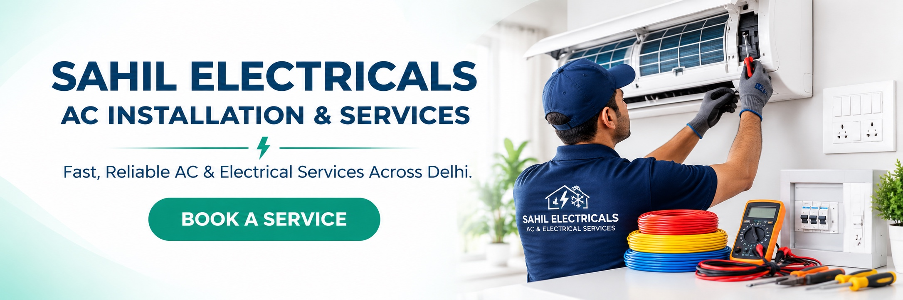

# Sahil Electricals Website

A responsive, single-page service website for Sahil Electricals, presenting AC installation and repair, electrical services, and home-appliance repair across Delhi.

**Live website:** [inamkhankhan050-maker.github.io/sahil-electricals-website](https://inamkhankhan050-maker.github.io/sahil-electricals-website/)



## Highlights

- Searchable AC, electrical and appliance service directory
- Service-specific WhatsApp booking messages with location and preferred-visit prompts
- Direct phone links and clear contact information
- Three-banner carousel with swipe, arrow and dot controls
- Responsive navigation and layouts for mobile and desktop
- SEO metadata and LocalBusiness structured data

## Built with

HTML · CSS · JavaScript · GitHub Pages

The site is static and has no build step or package installation.

## Run locally

Open `index.html` in a browser, or start a local server:

```sh
python3 -m http.server 8000
```

Then visit [http://localhost:8000](http://localhost:8000).

## Main files

- `index.html` — page structure and metadata
- `styles.css` — visual system and responsive layouts
- `script.js` — service cards, search, WhatsApp URLs, navigation and carousel
- `assets/images/` — banners and service photography
